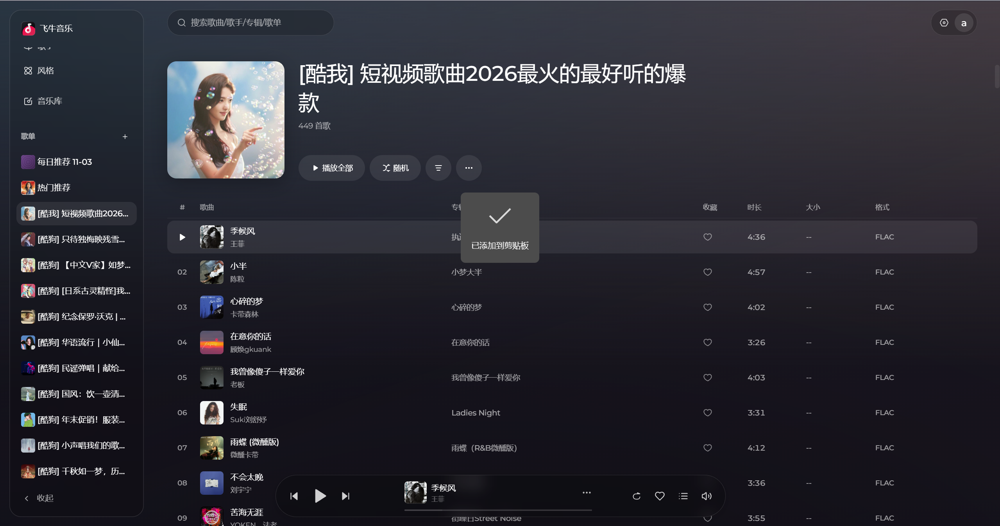
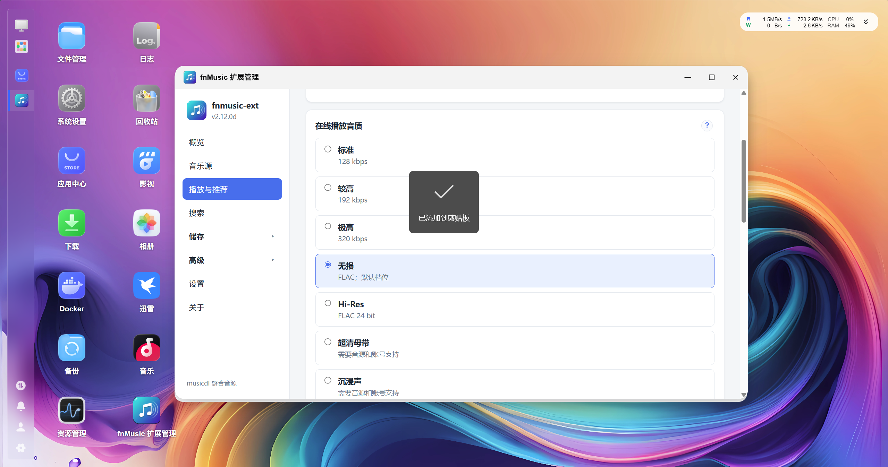

<div align="center">

# fnmusic-ext · 飞牛音乐扩展

**熟悉的飞牛音乐，不止于本地曲库。**

在原生 Web 与 App 中搜索、播放和收藏在线音乐，让在线发现与 NAS 曲库连在一起。

[](https://github.com/javycoder/fnos_music_ext/actions/workflows/ci.yml)
[](https://github.com/javycoder/fnos_music_ext/releases/latest)
[](LICENSE)
[](https://github.com/javycoder/fnos_music_ext/stargazers)

[**下载安装**](https://github.com/javycoder/fnos_music_ext/releases) · [快速上手](#快速上手) · [使用教程](#使用教程) · [更新日志](CHANGELOG.md) · [问题反馈](https://github.com/javycoder/fnos_music_ext/issues) · [Gitee 镜像](https://gitee.com/javycoder/fnos_music_ext)

</div>

> 面向 fnOS 官方音乐应用 `trim.music` 的社区扩展，非飞牛官方产品。保留官方客户端，通过可逆的代理接管增加能力；**不修改官方二进制或 nginx 配置，不直接写入官方数据库**。停止扩展即可恢复官方直连。

## 界面预览

**在飞牛音乐里，继续用熟悉的方式听歌。**



**在扩展管理里，集中设置音源、音质与推荐。**



<sub>截图用于展示界面；实际功能与外观以安装版本为准，歌曲可用性与实际音质取决于音源及账号权益。</sub>

## 一眼了解

| 能力 | 你可以做什么 |
| :--- | :--- |
| **原生入口** | 继续使用官方飞牛音乐 Web / App，无需换一套播放器 |
| **三类音源** | 在 musicdl、网易云 musicbox、洛雪 lxmusic 中选择主音源 |
| **在线搜索与播放** | 本地结果优先，在线结果随后展示，适配歌词、封面与客户端播放 |
| **独立音质设置** | 在线播放与 App 下载分别选音质，支持七档偏好及缺档降级 |
| **推荐与歌单** | 每日推荐、热门推荐、猜你喜欢，以及按用户选择的公共歌单 |
| **在线转本地** | 边听边存、封面内嵌、可选歌词落盘与收藏自动绑定本地 |
| **家庭多用户** | 在线收藏隔离，公共歌单按用户配置；网易账号歌单可跨主音源常驻 |
| **集中管理** | 音源配置、主题、日志导出、更新检查与存储维护，一个入口完成 |

**先了解三点：** 主音源三选一，并非同时聚合全部提供者；项目不附送可用的洛雪脚本；安装扩展不等于获得第三方平台的会员或付费内容权限。

## 快速上手

### 1. 准备环境

- 已安装并启动官方 **飞牛音乐**；FPK 声明最低 fnOS 版本为 **1.2.0**。
- 支持 `x86_64`、`aarch64 / ARM64`，不支持 ARM32。
- 默认通过 **Docker** 运行音源服务，也提供无需 Docker 的 **native 原生部署**；代理始终在宿主机运行，两种音源部署形态不可同时启用。
- NAS 能访问所选音源。当前仓库的官方音乐适配基线为 **1.0.10**，核对记录见 [FNMUSIC_COMPAT.json](FNMUSIC_COMPAT.json)，不代表对所有新版的兼容承诺。

### 2. 安装扩展

1. 前往 [GitHub Releases](https://github.com/javycoder/fnos_music_ext/releases) 下载正式版 `.fpk`。访问困难时可查看 [Gitee 发行页](https://gitee.com/javycoder/fnos_music_ext/releases)，以该页实际资产与下载说明为准。
2. 打开 fnOS **应用中心 → 手动安装**，选择 FPK，按向导选择初始音源并安装。
3. 从飞牛桌面打开 **fnMusic 扩展管理**，完成下表中的配置并保存。

| 选择的主音源 | 首次配置 |
| :--- | :--- |
| **musicdl** | 勾选需要的平台，建议先少量启用，确认搜索与播放正常后再扩展 |
| **网易云 musicbox** | 按需扫码登录，以使用账号歌单及相应账号权益 |
| **洛雪 lxmusic** | 自行导入可信 `.js` 音源脚本，测试、激活并保存；仅安装服务不代表已具备播放解析能力 |

### 3. 开始听歌

回到**官方飞牛音乐**，搜索歌曲，选择带来源标记的在线结果播放。音源、音质与储存设置继续在扩展管理页调整，不需要重新安装。

> **管理页入口：** 从飞牛桌面，或已登录管理员账号的飞牛页面 `/app/fnmusic-ext/` 打开。不要直接访问或向公网暴露内部 `8774` 端口。
>
> **版本选择：** 稳定使用请选择正式版；标记为 Pre-release 的版本用于尝鲜反馈，功能和稳定性可能变化。本文涵盖当前开发分支能力，部分功能可能尚未进入正式版，请以对应发行说明为准。

---

## 阅读导航

[音源怎么选](#音源怎么选) · [使用教程](#使用教程) · [源码安装](#源码安装) · [配置与维护](#配置与维护) · [工作原理](#工作原理) · [常见问题](#常见问题) · [开发与文档](#开发与文档) · [免责与版权声明](#免责与版权声明) · [Star 支持](#star-支持)

## 音源怎么选

**主音源四选一，可随时在管理页切换（默认仍为 musicdl）。** 洛雪的「多个脚本同时激活」与网易的「歌单常驻」是附加能力，不改变主音源单选规则。

| 主音源 | 适合场景 | 能力与边界 |
| :--- | :--- | :--- |
| **网易云免扫码 neteasefree** | 免扫码搜索播放（可选第四源） | 默认关闭；走第三方后端（默认示例占位须在管理页确认风险，可自建地址覆盖，仅支持 https）；启用后网易云歌单常驻自动停用 |
| **musicdl** | 按需选择多个平台搜索 | 当前登记 57 个 SDK 平台类；登记不等于每个平台都可播放，部分资源受登录、DRM 或交付格式限制 |
| **网易云 musicbox** | 网易搜索、账号歌单与推荐 | 支持扫码登录；会员、付费及试听限制仍由平台和账号决定 |
| **洛雪 lxmusic** | 使用自己信任的自定义源脚本 | 搜索、歌词与榜单由内置平台接口提供，播放解析交给用户脚本；不提供或保证可用脚本 |

musicdl 平台编号与短名见 [平台清单](musicdl-service/PLATFORMS.md)。洛雪兼容层基于 [XCQ0607/lxserver](https://github.com/XCQ0607/lxserver)，不保证所有第三方脚本兼容或长期有效。

## 使用教程

### 搜索、播放与音质

1. 在管理页选择主音源，保存后回到飞牛音乐重新搜索。
2. 搜索结果先展示本地曲库，再展示在线结果。网易与洛雪支持按需深分页，musicdl 参与首屏聚合；细节见 [搜索分页说明](docs/SEARCH_PAGINATION.md)。
3. 在「播放与推荐」中分别设置**在线播放音质**与 **App 下载音质**。App 下载可选「跟随 App」。

| 标准 | 较高 | 极高 | 无损 | Hi-Res | 超清母带 | 沉浸声 |
| :---: | :---: | :---: | :---: | :---: | :---: | :---: |
| `standard` | `higher` | `exhigh` | `lossless` | `hires` | `jymaster` | `sky` |
| 128 kbps | 192 kbps | 320 kbps | FLAC 无损 | FLAC 24 bit | 母带级，规格依音源 | 沉浸 / 空间音频，规格依音源 |

所选档位不可用时逐级降低，不反向升档；**选择无损并不保证取得无损资源**，不会把低码率音频转成 FLAC 冒充无损。高档位依赖歌曲、音源脚本与账号权益，musicdl 不保证每个平台支持七档。网易无对应权益的部分歌曲可能标记 `[VIP]`，且仅能试听。

客户端兼容播放可使用 AAC / HLS 转码，相关能力依赖 ffmpeg；兼容转码不等于原文件无损交付。官方旧下载协议中的 `standard` 表示 MP3 320k，与新界面的「标准」128k 不是同一个含义，升级时会迁移旧偏好。

<details>
<summary><strong>可选：播放直连（Beta）</strong></summary>

网易、musicdl、洛雪分别提供独立开关，默认关闭。开启后，符合条件的原文件在线播放可通过 HTTPS 302 交给客户端向源站取流；本地文件和完整缓存仍优先由 NAS 供流，HLS 与 App 下载不受此开关影响。

直连受客户端出口 IP、UA、Referer、CORS、临时链接和平台限制影响，不能保证所有资源或客户端可用。出现无法播放时，先关闭对应直连开关，再重新起播，回到 NAS 代理交付。


</details>


排序使用稳定脚本 ID。停用保留历史位置，新激活项追加，删除清理对应项；非洛雪主源时只保存本地设置，不启动音源服务。**导入前请自行审查来源安全，不要使用来历不明的脚本。**

第四源 neteasefree 为第三方后端：默认关闭，启用前须在管理页填写后端地址并确认第三方风险；默认地址仅为示例占位，可自建后端地址覆盖（仅支持 https），升级时随备份透传不丢失。后端不可达时搜索结果排除该源，管理页显示源不可用。

新导入不自动授权不安全 VM；需要额外权限的脚本应明确提示，而不是静默放宽环境。脚本仍在 Node.js 运行时执行：Docker 部署在容器内，原生部署在宿主机上，不能将其视为完整安全沙箱。

### 配置洛雪自定义源

1. 在音源设置中选择洛雪，通过 **URL、电脑上传 `.js`、NAS 文件选择**之一导入脚本。
2. 检查脚本来源及权限提示，执行测试，再激活需要的脚本。可以同时激活多个。
3. 在「高级 → lx音乐源」配置自动切换、脚本顺序和平台优选。

- **自动切源开启：** 先按目标音质遍历脚本，再降低音质；开启平台优选后，只在当前脚本声明的平台范围内寻找可信同曲。
- **自动切源关闭：** 只在原平台首个就绪且兼容的脚本内降档，不跨脚本或平台。
- **脚本排序：** 使用稳定脚本 ID；停用保留历史位置，新激活项追加，删除时清理对应项。非洛雪主音源时保存设置不意味着启动洛雪服务。

> **脚本是可执行代码，不是普通配置。** 请只导入可信来源，不能把 Node.js 运行环境当成完整安全沙箱。Docker 模式在容器内执行，native 模式在宿主机执行；新导入脚本不会自动获得不安全 VM 授权。

### 推荐、歌单与家庭账号

| 功能 | 配置方式与行为 |
| :--- | :--- |
| **每日推荐 / 热门推荐** | 独立总开关；每日推荐按账户隔离，实际推荐来源受主音源、账号和配置影响 |
| **猜你喜欢** | 默认纯本地计算，排除当前用户本地收藏后至少有 20 首有效本地歌曲才展示；每次最多 20 首，缓存 30 分钟，过期后下次读取更新 |
| **公共推荐歌单** | 默认关闭；管理页先选择飞牛音乐用户，再勾选、排序网易或洛雪歌单，每人最多 50 份；musicdl 暂不接入 |
| **网易账号歌单** | 登录后可只读展示账号自建歌单；这不是向网易账号写入歌单的同步工具 |
| **网易歌单常驻** | 开启后，切换到 musicdl 或洛雪仍可显示和播放网易歌单；账号歌单需登录，公共歌单可匿名使用 |
| **在线收藏** | 家庭用户彼此隔离；可选在收藏或加入歌单后自动下载，待官方收录再绑定本地歌曲 |

网易歌单常驻会额外保留网易服务，**不代表搜索变为多个提供者混合搜索**。公共歌单按用户保存在配置中，新用户默认没有所选歌单。

<details>
<summary><strong>可选：大模型推荐</strong></summary>

在「高级 · 大模型」填写 Base URL、API Key 和模型，选择 Chat Completions 或 Responses 协议，然后**独立勾选**「大模型每日推荐」或「大模型猜你喜欢」并保存。仅填写接口不会开启任何用途；接口不完整时不调用模型。

- **每日推荐：** 显式启用且接口完整时，为每位用户生成个人推荐，并由本地曲库补齐；否则保留音源原生推荐及本地兜底流程。关闭每日推荐总开关会关闭该歌单链路。
- **猜你喜欢：** 支持个人口味、本地探索与新歌联动；仍要求至少 20 首本地候选。数量可设为 0–100 的整数（默认 20，0 停止该模式的生成与展示），生成间隔默认 0.5 小时，最小 0.5 小时。
- **批次刷新：** 保存启用后后台预生成；每批首次被客户端获取后才开始计算间隔，达到间隔后预生成下一批。未获取的批次不会仅因时间流逝而轮换，这不是简单的缓存失效时间。
- **恢复本地模式：** 取消勾选大模型猜你喜欢即可恢复纯本地计算，已保存参数保留。
- **控制费用：** 可设单次输出 token 上限及每日 token 上限，在管理页查看用量与最近失败。每日上限默认 1000000，0 表示不限制；预算不是第三方账单或费用的保证。

使用外部模型会将推荐所需的音乐偏好等上下文发送给所配置的服务商，请事先确认数据处理政策、服务条款及费用。

</details>

### 边听边存与曲库管理

「边听边存」默认开启：在线音频完整下载后可保存到本地曲库，后续优先复用已核对的本地文件；切歌后的未完成下载可按并发限制转后台续传。

1. 在「存储 → 目录设置」选择**下载目录**和**歌曲缓存目录**，可使用飞牛文件选择器或手动输入。
2. 下载目录应属于希望被官方扫描的曲库；留空时自动探测共享曲库。缓存目录留空时使用安装目录下的 `cache/`。
3. 按需选择存放方式、命名规则、封面和歌词选项，保存并生效。

| 设置 | 说明 |
| :--- | :--- |
| **下载 / 缓存分离** | 两者不能相同或互为父子；更改缓存目录会迁移去重标记，不搬迁旧音频缓存 |
| **存放方式（Beta）** | 歌曲平铺、歌手 / 歌曲、专辑 / 歌曲、歌手 / 专辑 / 歌曲；仅影响后续落盘 |
| **文件命名** | 支持 `{artist}`、`{title}`、`{source}`，默认 `{artist} - {title}` |
| **封面 / 歌词** | 默认内嵌封面；同名 `.lrc` 歌词可选开启，默认关闭 |
| **收藏自动绑定** | 默认关闭；显式收藏或加入歌单后才触发后台下载，浏览列表不会触发音频下载 |
| **远程目录写入** | 可自动判断直接写入或本地中转，避免将远程挂载简单当成本地磁盘 |

<details>
<summary><strong>维护前必读：整理已有歌曲与清理文件</strong></summary>

**「整理」会实际移动文件。** 二次确认后递归处理当前下载目录中的歌曲，包含用户自行放入的文件；依据音频标签、官方曲库只读记录和扩展已有记录补充信息，不按文件名猜测歌手或专辑。缺少必要信息、无法识别或被占用的文件会跳过。

原文件名和标签保持不变，重名增加序号，可识别的同词干歌词与封面随迁；目录封面仅在关联明确时复制，原图保留。任务在后台运行，刷新页面后可继续查询进度；迁移记录位于歌曲缓存目录 `organize-journal/<任务ID>.jsonl`。

**请先备份，再整理，最后在飞牛音乐中重新扫描曲库。** 文件移动可能影响播放、收藏和歌单关联；整理不直接修改官方数据库，也不保证官方关联自动恢复。建议从飞牛桌面管理员入口使用该维护功能。

「清理垃圾文件（Beta）」用于清理遗留临时文件与过期日志，会展示回收空间。执行前请阅读风险提示并核对范围，不要将其视为曲库备份工具。

</details>

## 源码安装

适合需要自定义部署或调试的用户；普通用户优先使用 FPK。完整依赖、参数与迁移要求见 [安装指南](docs/INSTALL.md)。宿主代理需要 **Python 3.11+**，脚本需要管理员权限。

```bash
sudo apt-get update && sudo apt-get install -y python3 python3-venv git
git clone https://github.com/javycoder/fnos_music_ext.git fnmusic_ext
cd fnmusic_ext
chmod +x install.sh extend.sh restore.sh proxy/run_proxy.sh
./install.sh
```

向导会配置主音源、WebUI 等选项，并执行接管检查。**源码安装的 WebUI 默认不启用**，需要在向导中选择，或显式添加 `--webui`。上述 clone 使用仓库默认分支；若需要固定版本，请先切换到所选正式发行 tag。

<details>
<summary><strong>非交互安装示例：选择一种执行</strong></summary>

```bash
# Docker：musicdl 酷我、咪咕 + 管理页
./install.sh --non-interactive --sources musicdl-kuwo,musicdl-migu --webui --extend

# Docker：网易云 + 管理页，安装后扫码登录
./install.sh --non-interactive --sources musicbox --webui --extend

# Docker：洛雪 + 管理页，安装后自行导入脚本
./install.sh --non-interactive --sources lxmusic --webui --extend

# native：无 Docker，网易云 + 管理页
./install.sh --deploy native --non-interactive --sources musicbox --webui --extend
```

native 模式会探测 Node.js、ffmpeg / ffprobe 等依赖；补装及降级行为见安装指南。切换部署形态、跨目录接管（`--adopt`）和旧版本迁移应先阅读指南，**不要从多个目录同时接管同一个官方 Socket**。

</details>

## 配置与维护

### 常用配置速查

优先使用管理页，完整键名、范围与说明见 [`.env.example`](.env.example)。配置由安装器和管理页维护，源码部署位于仓库根目录 `.env`。支持热重载的白名单项默认约每 2 秒检测；端口及部分进程参数仍需重启，不能假定所有配置立即生效。

| 用途 | 配置项 | 默认 / 说明 |
| :--- | :--- | :--- |
| 播放音质 | `FNMUSIC_PLAY_QUALITY` | `lossless`，七档取值见音质教程 |
| App 下载音质 | `FNMUSIC_DOWNLOAD_QUALITY` | `app`，跟随 App |
| 洛雪自动切源 / 平台优选 | `FNMUSIC_LX_AUTO_SWITCH` / `FNMUSIC_LX_PLATFORM_PREFERRED` | 分别为 `true` / `false` |
| 洛雪脚本顺序 | `FNMUSIC_LX_SOURCE_ORDER` | 稳定脚本 ID 的 JSON 数组，建议在管理页排序 |
| 三类音源直连 | `FNMUSIC_NETEASE_DIRECT_PLAY` / `FNMUSIC_MUSICDL_DIRECT_PLAY` / `FNMUSIC_LX_DIRECT_PLAY` | 均为 `false`，Beta |
| 边听边存 | `FNMUSIC_TEE_SAVE_ENABLED` | `true` |
| 下载 / 缓存目录 | `FNMUSIC_TEE_SAVE_DIR` / `FNMUSIC_CACHE_DIR` | 留空自动选择；必须分离 |
| 目录布局 / 文件名 | `FNMUSIC_DOWNLOAD_LAYOUT` / `FNMUSIC_LIBRARY_NAME_PATTERN` | `flat` / `{artist} - {title}` |
| 封面 / 歌词落盘 | `FNMUSIC_AUTO_COVER` / `FNMUSIC_LYRIC_AUTO_DL` | 分别为 `true` / `false` |
| 每日 / 热门推荐 | `FNMUSIC_RECOMMEND_DAILY` / `FNMUSIC_RECOMMEND_HOT` | 均为 `true` |
| 公共 / 网易账号 / 网易常驻歌单 | `FNMUSIC_PUBLIC_PLAYLISTS_ENABLED` / `FNMUSIC_NETEASE_MY_PLAYLISTS` / `FNMUSIC_NETEASE_PLAYLIST_RESIDENT` | 均为 `false` |
| 收藏自动绑定本地 | `FNMUSIC_FAV_AUTO_BIND` | `false` |
| 大模型连接 | `FNMUSIC_LLM_BASE_URL` / `FNMUSIC_LLM_API_KEY` / `FNMUSIC_LLM_MODEL` | 只填连接不会启用用途 |
| 大模型用途 | `FNMUSIC_LLM_DAILY_ENABLED` / `FNMUSIC_LLM_LIKED_ENABLED` | 均为 `false`，独立开启 |

### 更新、停止与还原

| 操作 | FPK 安装 | 源码安装 |
| :--- | :--- | :--- |
| **更新** | 在应用中心安装新版本 FPK，走应用升级流程 | 备份后更新代码并重新运行 `./install.sh`；固定 tag 或历史版本迁移请先看指南 |
| **停止扩展** | 应用中心停止，恢复官方直连 | `./restore.sh`，保留配置与数据 |
| **重新启用** | 应用中心启动 | `./extend.sh`，重新接管并自检 |

- 升级钩子会备份、恢复所支持的配置与部分用户数据，**不等于完整 NAS / 曲库备份**。重要配置、脚本、歌单数据和音乐文件请另行备份。
- `appcenter-cli install-fpk` 不用于覆盖升级已安装应用；FPK 用户优先走应用中心。
- 卸载前会生成存储卷根目录下的 `fnmusic-ext-backup-<时间戳>.tar.gz`，备份可能含登录态与密钥，请妥善保管。
- `./restore.sh --full` 是破坏性清理，会删除配置、登录态及部分缓存和用户数据，**不是普通还原或升级命令，也不保证清除所有外置目录与数据**。
- 管理页「关于」可检查正式版更新，优先 GitHub，失败回退 Gitee；仅展示说明、跳转下载，不自动安装，也不推送预发布更新。

## 工作原理

### 官方入口不变，扩展在中间适配

```text
飞牛音乐 Web / App
        │
        ▼
官方 nginx（不修改配置）
        │ /var/run/trim_music.socket
        ▼
fnmusic-ext 代理（宿主机 systemd）
        ├── 本地业务 / 未扩展接口 ──► 官方音乐后端
        ├── 在线搜索、播放、歌词、封面、歌单适配
        ├── 缓存、转码、下载落库 ──► 本地曲库
        └── 按需调用音源服务
                ├── musicdl   127.0.0.1:8768
                ├── musicbox  127.0.0.1:8770
                └── lxmusic   127.0.0.1:8772

飞牛桌面 / 管理员网关
        └── /app/fnmusic-ext/ ──► WebUI 127.0.0.1:8774
```

接管时，将官方 Socket 安全移至 `/var/run/trim_music_upstream.socket`，代理占据原入口；本地业务继续透传，需要扩展的接口由代理适配。接管过程包含预检、身份核验、就绪检查及异常回滚；停止扩展时恢复原入口。

官方曲库数据库**只读访问**。收藏、歌单等需要写入的业务通过官方接口完成，所以“不直接写库”不等于“不会改变任何官方业务数据”。

### Docker 与 native 分别运行什么

| 层次 | Docker（默认） | native |
| :--- | :--- | :--- |
| 核心代理 | 宿主机 systemd + Python 虚拟环境 | 同左 |
| 音源与管理服务 | 单个 `fnmusic-sources` 容器，supervisor 按需启停 | 宿主机 systemd + supervisord |
| 配置与持久数据 | `.env`、`sources-data/` 等持久路径 | 共用相同配置与持久路径 |

服务仅监听本机回环地址。通常只启用当前主音源及可选 WebUI；洛雪自身还包含解析服务，开启网易歌单常驻时可额外保留 musicbox。**切源不是把所有提供者一起启动搜索。**

## 常见问题

<details>
<summary><strong>搜得到但播不了，或只能听几十秒？</strong></summary>

先区分源站、账号权益、网络与扩展适配问题。网易部分歌曲没有对应权益时只提供试听；musicdl 平台或洛雪脚本也可能失效。建议先缩小到已验证的平台、在管理页测试洛雪脚本，并关闭 Beta 直连后重试。搜索有结果、脚本初始化成功或返回 URL，都不等于音频已经可以完整播放。

</details>

<details>
<summary><strong>为什么选择无损，得到的却不是 FLAC？</strong></summary>

设置的是目标偏好，不是交付承诺。资源缺失、账号权限不足或源脚本不支持时会降档；实际格式与品质应以返回媒体证据为准，不能用扩展名、请求档位或“链接解析成功”代替验证。

</details>

<details>
<summary><strong>管理页打不开，或提示没有权限？</strong></summary>

FPK 用户从飞牛桌面以管理员身份打开；源码用户确认安装时启用了 WebUI。使用已登录的飞牛网关入口，不要用 `NAS_IP:8774` 代替管理入口，也不要自行伪造管理员请求头绕过鉴权。

</details>

<details>
<summary><strong>外网域名可以搜索，却不能播放或加载封面？</strong></summary>

检查自己配置的外层反向代理：媒体缓冲、超时、Host、Range 和鉴权头转发都可能影响播放，尤其要核对 `proxy_buffering off`。不要为此修改官方 nginx 配置；示例见 [安装指南](docs/INSTALL.md)。开启直连后还需区分 NAS 与客户端各自的网络出口。

</details>

<details>
<summary><strong>切换音源后仍看到网易歌单，或者配置没有变化？</strong></summary>

网易歌单可能来自「网易云歌单常驻」，不会因此混入其他主音源的搜索。配置问题则先确认已保存、是否属于热重载项，并重新搜索以避开旧结果；需要时从应用中心重启，源码部署可执行 `./extend.sh`。

</details>

<details>
<summary><strong>歌曲已下载，但没有出现在官方曲库或收藏里？</strong></summary>

确认文件完整落盘、下载目录属于官方扫描范围、目录可读，并等待或手动触发官方扫描。自动绑定需要先显式开启，并等待官方收录后才通过官方接口完成；移动歌曲或整理目录后，也应重新扫描，不能保证旧收藏或歌单关联自动恢复。

</details>

<details>
<summary><strong>如何导出日志并反馈问题？</strong></summary>

在管理页「关于 → 导出日志」下载近 3 天 `.logzip`，到 [GitHub Issues](https://github.com/javycoder/fnos_music_ext/issues) 提交：扩展版本、官方音乐版本、Docker / native、主音源、客户端、复现步骤及错误时间。

日志包含脱敏处理，但**分享前仍需自行检查**，不要公开 Cookie、访问令牌、大模型密钥、私人路径或有隐私的歌单信息。安装排障可查看 `/var/log/apps/fnmusic-ext-install.log`；安全问题请参照 [SECURITY.md](SECURITY.md)，仅提交不含密钥、私人路径等敏感信息的影响与复现，不要在公开 Issue 中披露秘密。

源码部署可只读查询代理健康状态：

```bash
curl -s --unix-socket /var/run/trim_music.socket http://localhost/_ext/healthz
```

健康状态用于分层定位问题，不代表所有第三方资源可播放。

</details>

## 开发与文档

| 入口 | 内容 |
| :--- | :--- |
| [安装指南](docs/INSTALL.md) | 部署依赖、安装参数、形态切换、历史迁移与外网反代 |
| [搜索分页说明](docs/SEARCH_PAGINATION.md) | 本地优先、在线结果池与深分页设计 |
| [musicdl 平台清单](musicdl-service/PLATFORMS.md) | 平台编号、短名与支持边界 |
| [更新日志](CHANGELOG.md) | 正式版与预发布版的功能和修复记录 |
| [贡献指南](CONTRIBUTING.md) | 开发约定、提交与验证要求 |
| [安全反馈](SECURITY.md) | 安全边界及漏洞报告方式 |

核心代码：`proxy/` 负责代理与业务适配；`musicbox-service/`、`musicdl-service/`、`lxmusic-service/` 提供音源；`webui-service/` 提供管理页；`container/` 管理服务编排；`packaging/fpk/` 构建应用包。

```bash
# 离线测试统一入口；需先按贡献指南与 CI 准备各服务依赖
python3 scripts/run_tests.py

# 本地构建 FPK；需准备 fnpack 等打包依赖
./packaging/fpk/build.sh
```

离线回归不等于真实源播放验证。涉及音源或媒体交付的修改，还需在独立测试环境检查初始化、搜索、取链及实际音频交付，不能将 URL 返回成功当成完整客户端播放通过。

安装版本取自 `VERSION`，通道取自 `RELEASE_CHANNEL`：例如 `2.12.0-4` 在预发布通道显示为 `v2.12.0e`，而 `2.11.0-4` 在稳定通道显示为 `v2.11.0`。数字修订号属于安装版本，不能因正式发布而剥离；文档更新本身不需要升版或创建 Release。

## 免责与版权声明

- **项目性质**：本项目为独立的社区开源扩展，与飞牛及各音乐平台不存在官方隶属、合作或背书关系。文中名称、商标与标识归各自权利人所有，仅用于说明兼容对象和技术来源。
- **软件许可**：项目代码依 [MIT 许可证](LICENSE) 提供，复制、修改和分发时须保留版权及许可声明；第三方依赖遵循其各自许可证。本声明不收窄 MIT 已授予的软件许可，也不额外授予音乐内容或平台服务权益。
- **内容版权**：本项目不托管或分发音乐资源；经第三方服务取得的音频、歌词、封面及元数据，其权利归相应权利人所有。软件开源不代表这些内容可被自由下载、传播或商用。
- **合法使用**：请仅访问、播放、缓存或下载自己有权使用的内容，并遵守适用法律、平台协议和账号授权范围。项目不提供会员、付费内容或 DRM 的绕过服务；技术研究或个人使用不当然构成版权授权。
- **第三方服务**：搜索、取链、推荐及音质依赖第三方接口、资源、网络与账号权益，可能随时失效、降级或变化。项目不保证歌曲可用、链接长期有效、指定音质可达或所有客户端兼容；账号使用风险及服务费用应由用户事先评估。
- **脚本与执行安全**：洛雪自定义脚本由用户自行选择和导入，是可执行代码，可能发起网络请求或访问运行环境。请审查来源与权限，不导入不可信脚本；容器及 VM 兼容机制不构成完整安全隔离，native 模式的宿主机执行风险尤需注意。
- **隐私与密钥**：登录态、API Key、歌单及日志可能包含敏感信息，请妥善保管配置、备份和导出文件。使用外部音源或大模型会向对应服务发送必要请求或推荐上下文，请先了解其隐私政策；日志脱敏不能替代人工检查，勿将内部管理端口暴露公网。
- **数据与维护风险**：缓存、下载、转码、曲库扫描、文件整理、升级与清理可能占用资源、移动文件或影响官方收藏和歌单关联。执行前请核对路径并独立备份重要数据；扩展的备份和还原机制不能替代完整备份，也不保证恢复所有数据或业务关联。
- **无担保与责任限制**：软件按 MIT 许可证以“原样”提供，不作适销性、特定用途适用性、不侵权或持续可用性等明示或默示担保。在适用法律允许的最大范围内，作者及版权持有人不对因使用或无法使用本软件造成的索赔、损害或其他责任负责；依法不得排除或限制的责任不受影响。
- **权利与安全反馈**：如认为项目代码、文档或展示内容涉及权利问题，请通过 [Issues](https://github.com/javycoder/fnos_music_ext/issues) 提供可核验的权利及具体内容信息，维护者将核实处理。漏洞、密钥泄露等敏感问题请遵循 [安全反馈指引](SECURITY.md)，不要公开提交秘密或个人信息。

## 致谢

感谢以下开源项目、社区及所有贡献者，让这份扩展成为可能：

- [CharlesPikachu/musicdl](https://github.com/CharlesPikachu/musicdl) — 多平台音乐能力。
- [darknessomi/musicbox](https://github.com/darknessomi/musicbox) — 网易云音乐相关能力。
- [XCQ0607/lxserver](https://github.com/XCQ0607/lxserver) 与洛雪音乐社区 — 自定义源兼容基础。
- 每一位提交代码、报告问题、完善文档和帮助验证的使用者。

## Star 支持

如果这个项目让你的飞牛音乐更好用了，欢迎点一个 **[⭐ Star](https://github.com/javycoder/fnos_music_ext)**。

Star 是支持，清晰的反馈、可靠的验证和文档贡献同样重要。

[](https://www.star-history.com/#javycoder/fnos_music_ext&Date)

<div align="center">

[返回顶部](#fnmusic-ext--飞牛音乐扩展) · [下载扩展](https://github.com/javycoder/fnos_music_ext/releases) · [参与贡献](CONTRIBUTING.md)

</div>
