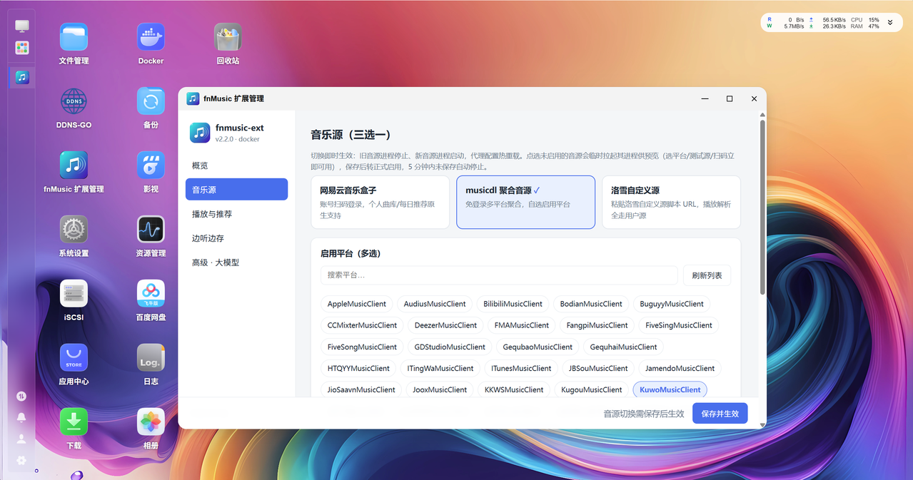

# fnmusic-ext · 飞牛音乐扩展

**保留飞牛音乐原生体验，为本地曲库补上在线搜索、播放、推荐与收藏能力。**

[](https://github.com/javycoder/fnos_music_ext/actions/workflows/ci.yml)

[GitHub](https://github.com/javycoder/fnos_music_ext) · [Gitee 镜像](https://gitee.com/javycoder/fnos_music_ext) · [下载安装包](https://github.com/javycoder/fnos_music_ext/releases) · [更新日志](CHANGELOG.md) · [详细安装指南](docs/INSTALL.md)

`fnmusic-ext` 是面向 fnOS（飞牛私有云）官方音乐应用 `trim.music` 的无侵入增强扩展。安装后，仍在熟悉的飞牛音乐 Web 端或 App 中搜索、听歌、收藏和管理歌单；音源与扩展设置则通过「fnMusic 扩展管理」完成。

扩展通过可逆接管官方后端 Unix Socket 实现协议中继与数据适配，**不修改官方程序、二进制或 nginx 配置，不直接写入官方数据库**。曲库数据库仅只读访问，收藏、歌单等业务写入通过官方接口完成；停止扩展即可恢复官方直连。



## 能做什么

### 在原生音乐里搜索与播放

- **本地优先的在线搜索**：本地曲库结果排在前面，当前所选音源的在线结果随后展示，并标注来源。网易与洛雪支持按需深分页，musicdl 仅参与首屏，详见[搜索分页说明](docs/SEARCH_PAGINATION.md)。
- **播放、歌词与封面适配**：在线歌曲可直接点播，优先复用曲库中已核对的本地文件；支持歌词与封面补全，在线封面默认通过同源代理返回，兼顾官方手机 App。
- **在线播放与下载分别选音质**：播放提供「高音质 / 平衡 / 流畅」偏好；App 下载提供「跟随 App / 无损原文件 / MP3 320k」。原文件交付不代表音源一定提供无损，实际品质受源站、账号权益与歌曲资源限制。
- **播放直连（beta）**：可按网易盒子、musicdl、洛雪独立开启 302 原文件播放；本地与完整缓存仍优先由 NAS 供流，HLS 与 App 下载不受影响。直连兼容性受客户端出口 IP、UA、Referer、CORS 与临时链接限制，失败后关闭开关重新起播即可恢复代理。
- **标准档转码**：为 App 的在线歌曲播放提供 AAC/HLS 分片，为标准档下载提供 MP3 320k，相关能力依赖 ffmpeg。网易无 VIP 权益时，部分歌曲会标记 `[VIP]`，可能仅能试听，扩展不会绕过账号权限。

### 推荐与歌单

- **每日推荐与热门推荐**：两个独立总开关；每日推荐按账户隔离，依次使用可用的音源原生推荐、明确启用的大模型推荐、本地曲库兜底。配置接口不会自动启用大模型；关闭大模型用途不关闭每日推荐歌单。
- **猜你喜欢**：默认使用纯本地计算：当前用户排除本地收藏后至少有 20 首有效本地歌曲时，显示在每日推荐下方，每次最多 20 首；首次读取生成，缓存 30 分钟，到期后下次读取更新，新增收藏或删除曲目后下次读取及时剔除。可在「高级 · 大模型」明确勾选大模型猜你喜欢，按个人口味、本地探索与新歌联动生成；歌曲数量可设为 0–100 的整数（默认 20，0 停止生成和展示），本地候选至少 20 首的门槛不变。启用保存后后台预生成首批；每批首次被客户端获取后开始计时，达到生成间隔后后台预生成下一批，未获取的批次不按时间过期或轮换。取消勾选恢复旧的纯本地行为，隐藏参数但保留已保存值。
- **公共推荐歌单**：在管理页浏览并勾选网易推荐、分类、精品、榜单歌单，以及洛雪歌单广场与榜单；支持关键词搜索网易/洛雪公共歌单，分类与搜索结果可连续加载到上游实际可返回的尽头，作为只读歌单显示在音乐页。默认关闭；musicdl 暂不接入此功能。
- **网易账号歌单**：扫码登录后，可将账号自建歌单以只读方式展示在飞牛音乐中。
- **网易云歌单常驻**：开启后，切到 musicdl 或洛雪仍可显示、播放网易歌单。账号歌单需要登录，网易公共歌单可匿名使用；此时网易服务会额外常驻，**不代表搜索变为多音源聚合**。
- **多用户收藏隔离**：家庭成员的在线红心收藏彼此独立；可选将在线收藏下载落库，再通过官方接口绑定本地歌曲。

### 从在线试听到本地曲库

- **边听边存**：在线听歌时后台缓存，可将完整下载的歌曲保存进官方曲库，后续优先复用本地文件。
- **缓存与下载目录分开设置**：支持飞牛文件选择器或手动路径；保存前校验可写性，两类目录不能相同或互为父子。更换缓存目录会迁移去重标记，不迁移旧音频缓存。
- **封面与歌词落盘**：落库歌曲可自动内嵌封面；可选下载同名 `.lrc` 歌词（默认关闭）。
- **自定义文件名**：支持 `{artist}`、`{title}`、`{source}`，默认 `{artist} - {title}`；规则对新落盘歌曲生效。

### 一个管理入口

「fnMusic 扩展管理」集中提供音源切换、网易扫码、musicdl 平台选择、洛雪脚本管理、音质与储存设置、推荐与大模型配置。

- 常用配置支持热生效，无需反复重装；不在热重载白名单内的配置仍需重启服务。
- 「设置」页提供外观主题：跟随系统（默认）、浅色或深色，切换后界面立即生效。
- 「边听边存」页提供「清理垃圾文件（Beta）」：清理遗留的临时文件与过期日志并显示回收空间；执行前有风险提示，请谨慎操作。
- 「关于」页支持检查正式版更新：优先 GitHub，失败回退 Gitee；发现新版后展示说明并跳转下载页，**不会自动安装，也不会推送预发布更新**。
- 运行日志按天滚动保留 3 天，可在「关于 → 导出日志」下载 `.logzip`，便于反馈问题；导出带脱敏处理，分享前仍请检查内容。

## 音源怎么选

**主音源三选一，可随时在管理页切换。** 洛雪的「多个脚本同时激活」与网易的「歌单常驻」是附加能力，不改变主音源单选规则。

| 主音源 | 适合的使用方式 | 使用前须知 |
| :--- | :--- | :--- |
| **网易云 musicbox** | 网易搜索、账号歌单与每日推荐 | 支持扫码登录；会员、付费与试听限制取决于账号权益 |
| **musicdl** | 按平台选择在线搜索来源 | 当前集成 57 个平台；可用性随上游变化，建议只启用自己验证可靠的平台 |
| **洛雪 lxmusic** | 使用自己信任的洛雪自定义源脚本 | 搜索、歌词与榜单由内置平台接口提供，播放解析交给用户脚本；不附送可用源 |

洛雪脚本可通过 **URL、电脑上传 `.js`、NAS 文件选择**三种方式导入，支持备注、测试、多个脚本同时激活与解析失败接力。**导入前请自行审查来源安全，不要使用来历不明的脚本。** 脚本在音源服务的 Node.js 运行时中执行：Docker 部署在容器内，原生部署在宿主机上，不能将其视为安全沙箱。

musicdl 平台编号与短名见 [平台清单](musicdl-service/PLATFORMS.md)。洛雪解析实现基于 [XCQ0607/lxserver](https://github.com/XCQ0607/lxserver)，项目使用 [pdone/lx-music-source](https://github.com/pdone/lx-music-source) 中的源进行验证，不保证所有第三方脚本兼容或长期可用。

## 安装与开始使用

### 前置条件

1. fnOS 已安装并启动官方 **飞牛音乐**应用。
2. 选择一种音源部署方式：**Docker（默认）**，或无需 Docker 的 **native 原生部署**。代理始终在宿主机运行，两种音源形态不能同时部署。
3. 确保 NAS 能访问所选音源；账号权限、网络条件与源站可用性会直接影响结果。
4. CPU 架构需为 `x86_64` 或 `aarch64/ARM64`；ARM32 暂不支持。

### 推荐：应用中心安装 FPK

1. 从 [GitHub Releases](https://github.com/javycoder/fnos_music_ext/releases) 下载最新正式版 `fnmusic-ext-<版本>.fpk`；GitHub 访问困难时可查看 [Gitee 发行版](https://gitee.com/javycoder/fnos_music_ext/releases)。
2. 在 fnOS「应用中心 → 手动安装」选择安装包，按向导选择初始音源。
3. 打开桌面「fnMusic 扩展管理」完成配置：网易可扫码登录，musicdl 勾选平台，洛雪需自行导入并激活源脚本后保存。
4. 回到官方飞牛音乐，在搜索框输入歌名，试听带来源标记的在线结果。

管理页使用飞牛管理员登录态，请从桌面入口或已登录的飞牛页面 `/app/fnmusic-ext` 打开，**不要直接访问 8774 端口**。

应用中心支持停止、启动与升级：停止扩展恢复官方直连，启动恢复增强能力。升级请在应用中心直接安装新 FPK，升级流程自动备份并恢复用户数据；`appcenter-cli install-fpk` 不用于覆盖升级已安装应用。卸载前会备份配置与数据为存储卷根目录的 `fnmusic-ext-backup-<时间戳>.tar.gz`，如需彻底清理，请自行确认并删除备份。

> 稳定使用请选择正式版。带字母后缀的 Pre-release 用于尝鲜反馈，未经完整人工验证，不保证稳定性。

### 进阶：源码脚本安装

在具备管理员权限的 fnOS 终端中执行：

```bash
sudo apt-get update && sudo apt-get install -y python3 python3-venv git
git clone https://github.com/javycoder/fnos_music_ext.git fnmusic_ext
cd fnmusic_ext
chmod +x install.sh extend.sh restore.sh proxy/run_proxy.sh
./install.sh
```

向导会选择主音源、是否启用 WebUI 与可选推荐配置，再执行接管验收。源码安装的 WebUI 默认不启用，如需图形管理请在向导中选择启用，或使用 `--webui`。

常用非交互示例：

```bash
# Docker：网易云 + 管理页，安装后扫码登录
./install.sh --non-interactive --sources musicbox --webui --extend

# Docker：musicdl 酷我、咪咕 + 管理页
./install.sh --non-interactive --sources musicdl-kuwo,musicdl-migu --webui --extend

# Docker：洛雪 + 管理页，装好后自行导入脚本
./install.sh --non-interactive --sources lxmusic --webui --extend

# 无 Docker：原生部署，依赖要求与补装行为见安装指南
./install.sh --deploy native --non-interactive --sources musicbox --webui --extend
```

安装参数、依赖、跨目录接管（`--adopt`）、形态切换与外网反代配置见 [详细安装指南](docs/INSTALL.md)。不要在同一台 NAS 上从多个目录同时接管官方 Socket。

## 配置与维护

配置由安装器与管理页维护，源码部署位于根目录 `.env`；完整配置说明见 [.env.example](.env.example)。优先在管理页修改，避免手动组合互相冲突的音源开关。

| 常用设置 | 配置项 | 说明 |
| :--- | :--- | :--- |
| 播放音质 | `FNMUSIC_QUALITY_MODE` | `high` / `balanced` / `smooth` |
| 播放直连（beta） | `FNMUSIC_NETEASE_DIRECT_PLAY` / `FNMUSIC_MUSICDL_DIRECT_PLAY` / `FNMUSIC_LX_DIRECT_PLAY` | 三项默认 `false`，独立控制原文件在线播放是否返回音乐源 HTTPS 302 |
| App 下载音质 | `FNMUSIC_DL_QUALITY` | `app` / `original` / `standard`；跟随 App 时仅显式标准档转 MP3，否则交付原文件 |
| 边听边存 | `FNMUSIC_TEE_SAVE_ENABLED` | 默认开启 |
| 下载 / 缓存目录 | `FNMUSIC_TEE_SAVE_DIR` / `FNMUSIC_CACHE_DIR` | 留空分别自动探测共享曲库 / 使用安装目录 `cache` |
| 下载存放方式 | `FNMUSIC_DOWNLOAD_LAYOUT` | `flat`（默认）、`artist`、`album`、`artist_album`；仅影响后续下载 |
| 落库文件名 | `FNMUSIC_LIBRARY_NAME_PATTERN` | 默认 `{artist} - {title}` |
| 封面 / 歌词落盘 | `FNMUSIC_AUTO_COVER` / `FNMUSIC_LYRIC_AUTO_DL` | 默认开启封面、关闭歌词 |
| 每日 / 热门推荐 | `FNMUSIC_RECOMMEND_DAILY` / `FNMUSIC_RECOMMEND_HOT` | 默认开启，可分别关闭 |
| 公共歌单 | `FNMUSIC_PUBLIC_PLAYLISTS_ENABLED` | 默认关闭，选单在管理页完成 |
| 网易账号歌单 / 常驻 | `FNMUSIC_NETEASE_MY_PLAYLISTS` / `FNMUSIC_NETEASE_PLAYLIST_RESIDENT` | 默认关闭；账号歌单仍需登录 |
| 收藏自动绑定本地 | `FNMUSIC_FAV_AUTO_BIND` | 默认关闭，显式收藏或加入歌单后下载并等待官方入库再绑定；浏览列表不触发音频下载 |
| 大模型接口 | `FNMUSIC_LLM_BASE_URL` / `FNMUSIC_LLM_API_KEY` / `FNMUSIC_LLM_MODEL` | 接口地址和密钥须完整；模型默认 `gpt-4o-mini`，仅填写接口不启用用途 |
| 大模型接口协议 | `FNMUSIC_LLM_PROTOCOL` | `chat`（默认，`/chat/completions`）或 `responses`（`/responses`），两种协议均完整实现 |
| 大模型单次输出上限 | `FNMUSIC_LLM_MAX_TOKENS` | 256–131072（默认 8192，含推理 token）；DeepSeek 等推理模型吃满预算导致正文为空时调大，或用 `FNMUSIC_LLM_EXTRA_BODY` 关闭思考（如 `{"thinking":{"type":"disabled"}}`） |
| 大模型每日 token 上限 | `FNMUSIC_LLM_DAILY_TOKEN_LIMIT` | 默认 1000000，0=不限制；达到后当天不再调用、次日自动重置，用量与最近失败见管理页及 `/_ext/healthz` |
| 大模型猜你喜欢 / 每日推荐 | `FNMUSIC_LLM_LIKED_ENABLED` / `FNMUSIC_LLM_DAILY_ENABLED` | 两项默认 `false`，需独立明确勾选；接口不完整时不调用模型 |
| 大模型猜你喜欢间隔 / 数量 | `FNMUSIC_LIKED_REFRESH_HOURS` / `FNMUSIC_LIKED_SIZE` | 间隔为有限数字且 ≥0.5 小时（默认 0.5，无上限）；数量为 0–100 整数（默认 20）；不是缓存失效时间 |

在「存储 → 目录设置 → 下载目录」中选择「存放方式(beta)」，点击「保存并生效」后，
后续下载和缓存转正使用新目录结构，已有歌曲继续复用原位置。默认「歌曲」为平铺，
其余选项为「歌手/歌曲」「专辑/歌曲」「歌手/专辑/歌曲」；新下载缺少元数据时使用
「未知歌手」「未知专辑」，歌词跟随音频，封面继续内嵌。

「整理」会在二次确认后递归处理当前下载目录中的全部歌曲，包括自行放入的文件。
它按音频标签、官方曲库只读记录和扩展已有记录补充信息；不根据文件名猜测歌手或专辑，
缺少必要信息、无法识别或被占用的歌曲会跳过。原文件名和标签保持不变，重名增加序号，
可识别的同词干歌词、封面随迁；目录封面仅在关联明确时复制，原图片保留。
任务在后台执行，页面可查看进度和原因，刷新后继续查询。迁移记录保存在歌曲缓存目录的
`organize-journal/<任务ID>.jsonl`，包含源路径、目标路径和扩展 `.ref` 更新，供中断后核对。
建议先备份；移动文件可能影响播放、收藏和歌单关联，完成后请在飞牛音乐中重新扫描曲库。
整理不会修改官方数据库，也不保证官方收藏和歌单关联自动恢复。该维护功能需从管理员网关访问。

在管理页「高级 · 大模型」填写接口后，按需勾选对应用途并「保存并生效」。已勾选但 Base URL 或 API Key 不完整时会明确警告，不会调用模型，也不会丢失勾选状态。猜你喜欢参数仅在该用途勾选时显示、校验并保存，空白、小数数量、非有限值或越界编辑不会被截断或静默恢复默认；取消勾选不会覆盖已保存参数。数量 0 仅在大模型猜你喜欢用途实际生效时禁用该歌单，未勾选时不改变原本的纯本地链路。

热重载默认每 2 秒检测 `.env` 白名单配置。端口、部分平台参数等非热重载项修改后，需重新启用服务。

源码部署的常用维护命令（FPK 用户优先使用应用中心）：

```bash
./extend.sh          # 重新启用并自检
./restore.sh         # 还原官方直连，保留配置与数据
./restore.sh --full  # 彻底清理，删除配置、登录态、缓存与收藏等数据
./install.sh --qr    # 网易云扫码登录，也可在管理页操作

# 检查代理健康状态
curl -s --unix-socket /var/run/trim_music.socket http://localhost/_ext/healthz
```

执行彻底清理前请自行备份。源码升级通常使用 `git pull && ./install.sh`；历史部署或形态迁移请先阅读安装指南，不要直接删除仍在使用的安装目录。

## 工作原理

```text
飞牛音乐 Web / App
        │
        ▼
官方 nginx（不修改配置）
        │ Unix Socket 可逆接管
        ▼
fnmusic-ext 代理（宿主机 systemd）
        ├─ 本地业务透传 ──► 官方音乐后端
        ├─ 在线搜索 / 播放 / 歌词 / 封面 / 歌单适配
        ├─ 缓存 / 转码 / 下载落库
        └─ 音源服务与 WebUI（仅监听本机）
                ├─ musicbox  127.0.0.1:8770
                ├─ musicdl   127.0.0.1:8768
                ├─ lxmusic   127.0.0.1:8772
                └─ WebUI     127.0.0.1:8774
```

音源服务默认合并在单个 `fnmusic-sources` Docker 容器，由 supervisor 按需启停；native 模式使用宿主机 systemd + supervisord。通常只启动当前主音源及可选 WebUI；网易歌单常驻开启且满足条件时，会额外保留 musicbox。切源不是同时启动所有音源搜索。

## 常见问题

**搜到歌曲却不能播放，或只能播放几十秒？** 先检查当前音源与账号权益。网易部分 VIP 歌曲无相应权益时只提供试听；第三方平台与洛雪脚本也可能失效。洛雪可先在管理页测试脚本，musicdl 可缩小到已验证的平台，必要时换源。

**切到洛雪后为什么还看到网易歌单？** 检查是否开启「网易云歌单常驻」。这是歌单供数与播放能力，不会把网易结果混入洛雪搜索；取消常驻后，非网易主音源下会回收对应进程，登录态保留。

**管理页打不开？** 源码安装请先确认已启用 WebUI；通过飞牛管理员已登录页面或桌面图标打开，不要把内部端口直接暴露到公网。

**外网域名访问时能搜索却不能播放或显示封面？** 检查外层反向代理的缓冲、超时、Host、Range 与鉴权头转发设置，尤其是 `proxy_buffering off`；不要修改官方 nginx 配置。完整示例见 [安装指南的外网反向代理章节](docs/INSTALL.md)。

**修改配置没变化？** 确认已保存，并区分热重载白名单与需重启项；源码部署可执行 `./extend.sh` 重新启用。修改音源平台等设置后，也应重新搜索以避免旧结果缓存干扰。

**如何反馈问题？** 在管理页「关于 → 导出日志」获取近 3 天 `.logzip`，附上扩展版本、部署方式、所选音源、客户端与复现步骤，到 [GitHub Issues](https://github.com/javycoder/fnos_music_ext/issues) 反馈。请勿公开登录 cookie、访问令牌、大模型密钥或未经检查的日志。

## 开发与文档

- [安装与部署](docs/INSTALL.md)：脚本参数、Docker / native、迁移与外网反代。
- [搜索分页](docs/SEARCH_PAGINATION.md)：本地优先、在线池与深分页行为。
- [musicdl 平台清单](musicdl-service/PLATFORMS.md)：平台编号、短名与退役情况。
- [更新日志](CHANGELOG.md) · [贡献指南](CONTRIBUTING.md) · [安全反馈](SECURITY.md)。

核心目录：`proxy/`（代理与业务适配）、`musicbox-service/`、`musicdl-service/`、`lxmusic-service/`（音源）、`webui-service/`（管理页）、`container/`（容器编排）、`packaging/fpk/`（应用包）。

```bash
python3 -m pytest          # 自动化测试；依赖与运行矩阵参见 CI 配置
./packaging/fpk/build.sh   # 本地打包到 dist/，需准备 fnpack 等构建依赖
```

版本号以根目录 `VERSION` 为准，功能变更见 `CHANGELOG.md`。发布须遵循项目发布规则，文档更新本身不要求修改版本号或创建 Release。

## 许可、使用边界与致谢

项目代码采用 [MIT 许可证](LICENSE)，以技术研究与个人使用为主要场景。软件许可不授予任何第三方音乐内容的使用权，也不替代平台协议或账号授权。

项目不托管音乐资源，不提供会员权限绕过服务；播放、缓存与下载的音频及元数据版权归原权利人所有。请仅访问自己有权使用的内容，遵守所在地区法律法规与第三方平台协议，支持正版。第三方脚本由用户自行提供并承担安全风险，源站可用性与音质不作保证。

感谢 [CharlesPikachu/musicdl](https://github.com/CharlesPikachu/musicdl)、[darknessomi/musicbox](https://github.com/darknessomi/musicbox)、[XCQ0607/lxserver](https://github.com/XCQ0607/lxserver) 与洛雪音乐社区及所有贡献者。
